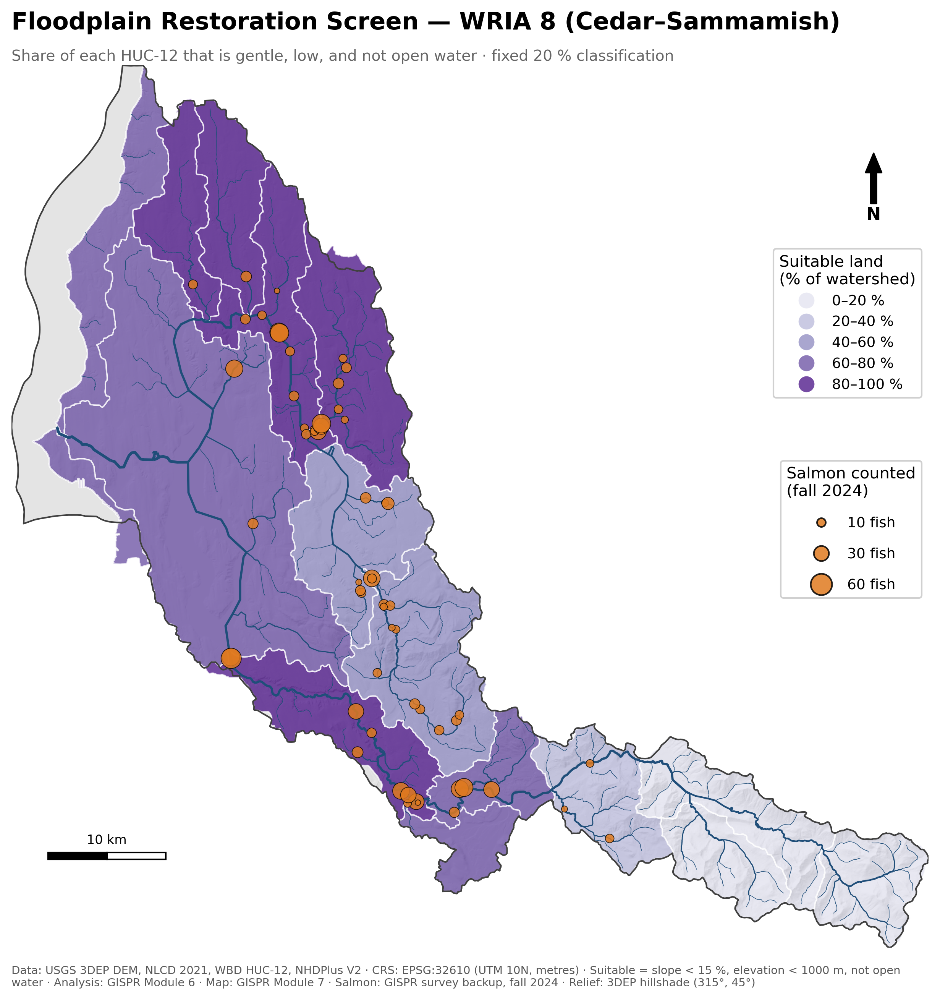

# GISPR Module 7 - Visualization

Floodplain restoration suitability maps for WRIA 8 (Cedar-Sammamish), built in Python and R.

## Interactive maps
- [Full notebook with working maps](https://jdoit0611.github.io/gispr-module7/Machtolff_GISPR_Module7_Visualization.html)
- [Restoration screen - folium (Python)](https://jdoit0611.github.io/gispr-module7/outputs/module7/restoration_screen_folium.html)
- [Restoration screen - leaflet (R)](https://jdoit0611.github.io/gispr-module7/outputs/module7/restoration_screen_leaflet.html)
- [Watersheds - leafmap](https://jdoit0611.github.io/gispr-module7/outputs/module7/watersheds_leafmap.html)
- [Split map - leafmap](https://jdoit0611.github.io/gispr-module7/outputs/module7/split_leafmap.html)

## Report map

More static maps are in the [Deliverables](Deliverables) folder.
